# 🛒 ShopSphere — Smart E-Commerce & Business Analytics Platform


ShopSphere is a full-stack e-commerce platform built using the MERN stack with integrated business analytics.  
It provides complete online shopping functionality along with data-driven insights using real-world Kaggle datasets.

This project combines:

- Full Stack Development
- Database Management
- Authentication Systems
- Admin Management
- Business Analytics
- Data Visualization
- CSV Export Automation

making it a complete real-world industry-level project.

---

# 📌 Project Overview

ShopSphere is designed to simulate a production-grade e-commerce system where users can:

- Register and login securely
- Browse products
- Search products
- Add items to cart
- Save products in wishlist
- Apply discount coupons
- Select payment methods
- Place orders
- Track order status
- Write reviews

At the same time, admin users can:

- Add products
- Delete products
- Manage customer orders
- Export reports

The unique feature of this project is the **Analytics Module**, where e-commerce business data is analyzed using Kaggle datasets and transformed into actionable business insights.

---

# 🎯 Why This Project Was Built

This project was built to demonstrate:

✅ End-to-end customer shopping lifecycle  
✅ Full-stack MERN architecture  
✅ Secure JWT authentication  
✅ Admin product and order management  
✅ Coupon engine implementation  
✅ Dynamic review and rating system  
✅ Business analytics using real-world data  
✅ SQL + Excel + Python + Power BI integration

---

# 🚀 Core Features

# 👤 Authentication System

Users can:

- Register account
- Login securely
- Logout
- Access profile page
- Reset forgotten password

Security implemented:

- JWT Authentication
- Password hashing using bcrypt
- Protected routes
- Role-based authorization

---

# 🛍 Product Management

Each product contains:

- Product name
- Description
- Price
- Discount price
- Category
- Brand
- Stock
- Images
- Badge
- Rating
- Reviews

Features:

- Product listing
- Product detail page
- Search products
- Category filtering
- Product stock tracking

---

# ❤️ Wishlist System

Users can:

- Add products to wishlist
- View saved wishlist products
- Remove products from wishlist

This helps users save products for later.

---

# 🛒 Cart System

Cart supports:

- Add product
- Increase quantity
- Decrease quantity
- Remove item
- Auto total calculation

The cart dynamically updates the total based on quantity.

---

# 💳 Checkout System

Checkout includes:

## Shipping Information

Users fill:

- Full Name
- Phone Number
- Street
- City
- State
- Pincode
- Country

---

## Coupon System

Available coupon:

```text
WELCOME10
```

Coupon features:

- Validate coupon
- Calculate discount
- Update final amount

---

## Payment Methods

Users can select:

- Cash on Delivery
- UPI
- Card
- Net Banking

---

# 📦 Order Management

After placing order:

Users can:

- View order history
- Track order status
- Check payment status

Order lifecycle:

```text
Pending → Processing → Shipped → Delivered
```

Admin can update order status.

---

# ⭐ Review System

Users can:

- Give product rating (1–5)
- Write review comments

The system automatically updates:

- Average rating
- Total review count

---

# 🛠 Admin Panel

Admin dashboard provides:

- Product management
- Order management
- CSV export

Admin features:

## Manage Products
- Add products
- Delete products
- View stock

## Manage Orders
- View customer orders
- Update order status
- Track payments

## Export Reports
Export sales report as CSV.

---

# 📊 Business Analytics Module

This is the unique and most important part of this project.

The analytics module uses a real-world Kaggle dataset.

Dataset used:

```text
Brazilian E-Commerce Public Dataset by Olist
```

This dataset includes:

- Orders
- Payments
- Reviews
- Products
- Customers
- Sellers

---

# Kaggle Dataset Integration

Dataset files:

```text
olist_customers_dataset.csv
olist_orders_dataset.csv
olist_order_items_dataset.csv
olist_order_payments_dataset.csv
olist_order_reviews_dataset.csv
olist_products_dataset.csv
olist_sellers_dataset.csv
product_category_name_translation.csv
```

These datasets are stored in:

```text
analytics/data/
```

---

# Analytics Performed

Using Python:

## 1. Monthly Orders Trend
Tracks customer order growth over time.

Generated:
```text
monthly_orders.csv
monthly_orders_trend.png
```

---

## 2. Payment Method Analysis
Shows payment distribution.

Generated:
```text
payment_summary.csv
payment_summary.png
```

---

## 3. Top Selling Products
Identifies top performing products.

Generated:
```text
top_products.csv
```

---

## 4. Customer Distribution by State
Shows where customers are located.

Generated:
```text
customers_by_state.csv
```

---

## 5. Review Analysis
Analyzes customer review patterns.

Generated:
```text
review_summary.csv
```

---

Analytics tools used:

- Python
- Pandas
- Matplotlib
- SQL
- Excel
- Power BI
- Tableau

---

# 🧑‍💻 How a New User Can Use This Website

## Step 1: Open Home Page

The user lands on:

```text
http://localhost:5173
```

Home page contains:

- Hero section
- Search bar
- Categories
- Featured products
- Offer banner

---

## Step 2: Register

Click:

```text
Sign Up
```

Enter:

- Name
- Email
- Password

Account is created.

---

## Step 3: Login

Click:

```text
Login
```

Enter credentials.

The user gets authenticated.

---

## Step 4: Browse Products

Users can:

- Search products
- Open product details
- View price
- Check stock
- Read description
- View ratings

---

## Step 5: Add to Cart

From product page:

```text
Add to Cart
```

The product is stored in the cart.

---

## Step 6: Add to Wishlist

Click:

```text
Add to Wishlist
```

The product is saved for later.

---

## Step 7: Manage Cart

Inside cart:

Users can:

- Increase quantity
- Decrease quantity
- Remove item

The total updates automatically.

---

## Step 8: Checkout

Click:

```text
Proceed to Checkout
```

Fill shipping details.

---

## Step 9: Apply Coupon

Use:

```text
WELCOME10
```

Discount gets applied.

---

## Step 10: Select Payment Method

Choose:

- COD
- UPI
- Card
- Net Banking

---

## Step 11: Place Order

Click:

```text
Place Order
```

Order gets created.

---

## Step 12: Track Order

Go to:

```text
My Orders
```

Track:

```text
Pending → Processing → Shipped → Delivered
```

---

## Step 13: Review Product

Users can:

- Give rating
- Write review

---

# 🛠 How Admin Can Use This Website

Login as admin.

Access:

```text
/admin
```

Admin can:

---

## Manage Products

Go to:

```text
/admin/products
```

Admin can:

- Add products
- Delete products
- Manage stock

---

## Manage Orders

Go to:

```text
/admin/orders
```

Admin can:

- View all customer orders
- Update status
- Monitor payments

---

## Export Reports

Admin can export:

```text
/api/admin/export/sales-report
```

This exports CSV data.

---

# 🏗 Project Structure

```text
ShopSphere/
│
├── backend/
│   ├── controllers/
│   ├── models/
│   ├── routes/
│   ├── middleware/
│   ├── utils/
│   └── server.js
│
├── frontend/
│   ├── src/
│   │   ├── components/
│   │   ├── pages/
│   │   ├── services/
│   │   └── App.jsx
│
├── analytics/
│   ├── data/
│   ├── python/
│   ├── sql/
│   ├── excel-reports/
│   ├── powerbi-dashboard/
│   └── tableau-dashboard/
│
├── screenshots/
└── README.md
```

---

# ⚙ Developer Setup Guide

## Clone Repository

```bash
git clone https://github.com/build-with-saurav/ShopSphere.git
cd ShopSphere
```

---

# Backend Setup

Go inside backend:

```bash
cd backend
```

Install dependencies:

```bash
npm install
```

Create `.env`

```env
PORT=5000
MONGO_URI=mongodb://127.0.0.1:27017/shopsphere
JWT_SECRET=replace-with-a-random-secret-of-at-least-32-characters
JWT_EXPIRE=7d
CLIENT_URL=http://localhost:5173
NODE_ENV=development
```

If `backend/.env` already exists, keep it and update only the values you need; do not replace it with the example file. Never commit `.env`. The backend loads this file relative to `backend/server.js`, waits for MongoDB before listening, and warns if `JWT_SECRET` is shorter than 32 characters.

Run backend:

```bash
npm run dev
```

Runs on:

```text
http://localhost:5000
```

---

# Frontend Setup

Go inside frontend:

```bash
cd frontend
```

Install dependencies:

```bash
npm install
```

Run frontend:

```bash
npm run dev
```

Runs on:

```text
http://localhost:5173
```

The frontend proxies `/api` to `http://localhost:5000` in development. To use another backend, set `VITE_API_PROXY_TARGET` in `frontend/.env`; for a deployed frontend set `VITE_API_URL` to the complete API base URL, including `/api`.

In development, the backend creates the documented `WELCOME10` coupon if it does not already exist. Existing coupons are not overwritten. Production does not receive this demo coupon automatically.

Products with missing or invalid image URLs display the bundled fallback image. Product image URLs can be supplied when products are created in the admin panel.

Admin pages require a signed-in user whose database role is `admin` or `manager`. New registrations are customers by default; grant an admin role only to a trusted account using your normal database administration process.

For a local demo, register the account first, then promote that account in the database selected by `MONGO_URI`, for example with `mongosh`:

```javascript
db.users.updateOne(
  { email: "your-admin@example.com" },
  { $set: { role: "admin" } }
)
```

---

# Analytics Setup

Go inside:

```bash
cd analytics/python
```

Install dependencies:

```bash
pip install pandas matplotlib
```

Run analytics:

```bash
python3 ecommerce_analysis.py
```

Reports generated inside:

```text
analytics/excel-reports/
```

---

# API Endpoints

## Authentication

```text
POST /api/auth/register
POST /api/auth/login
POST /api/auth/forgot-password
PUT  /api/auth/reset-password/:token
GET  /api/auth/profile
```

---

## Products

```text
GET    /api/products
GET    /api/products/categories
GET    /api/products/:id
POST   /api/products
PUT    /api/products/:id
DELETE /api/products/:id
POST   /api/products/:id/review
```

---

## Cart

```text
POST   /api/cart
GET    /api/cart
PUT    /api/cart
DELETE /api/cart/:productId
```

---

## Wishlist

```text
POST   /api/wishlist
GET    /api/wishlist
DELETE /api/wishlist/:productId
```

---

## Orders

```text
POST /api/orders
GET  /api/orders
GET  /api/orders/admin
PUT  /api/orders/:id/status
```

`GET /api/orders/admin` and the order-status endpoint require the `admin` or `manager` role.

---

## Coupons

```text
POST /api/coupons/validate
```

---

# 📸 Application Screenshots

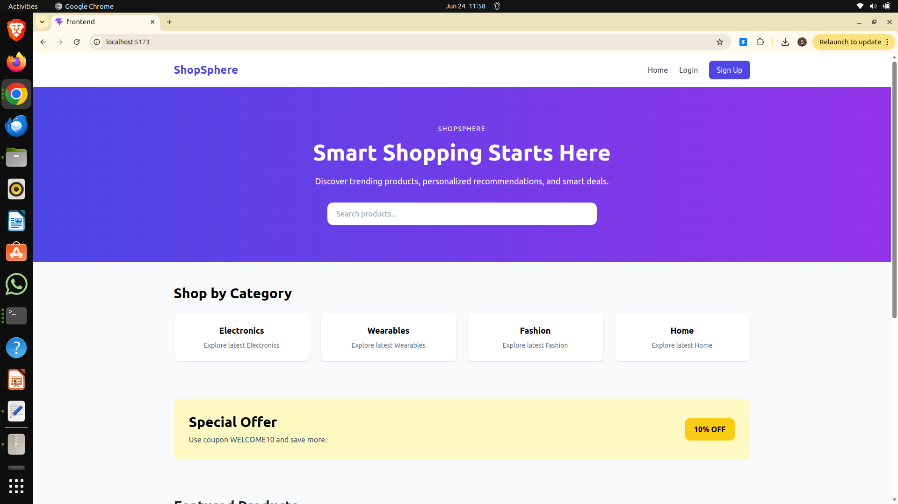
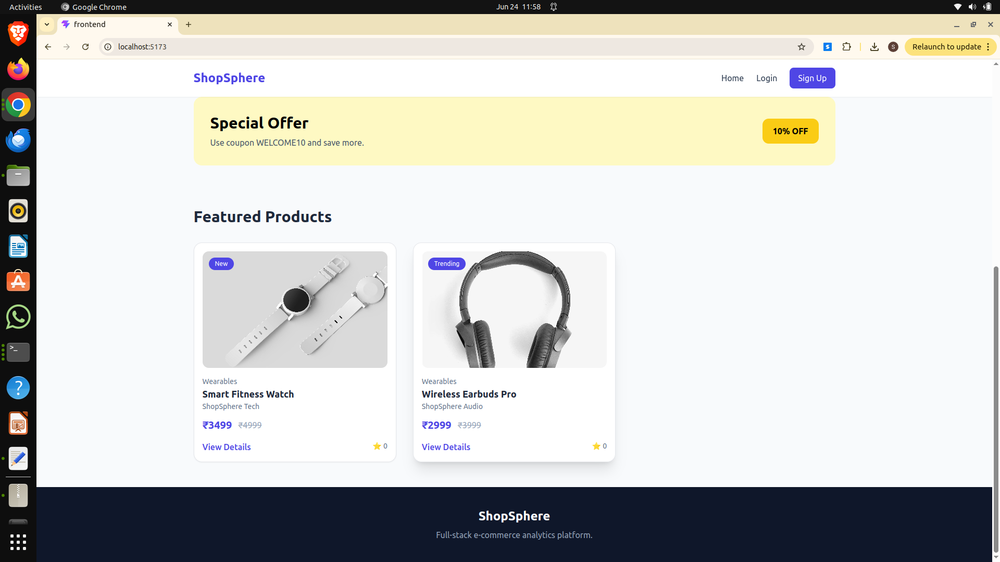
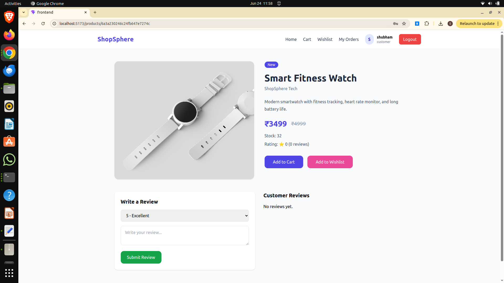
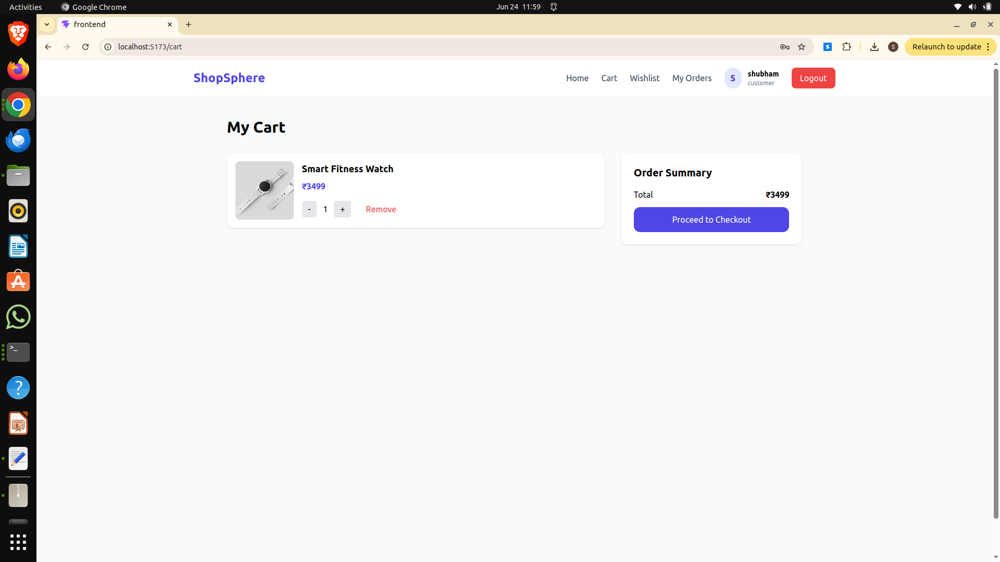
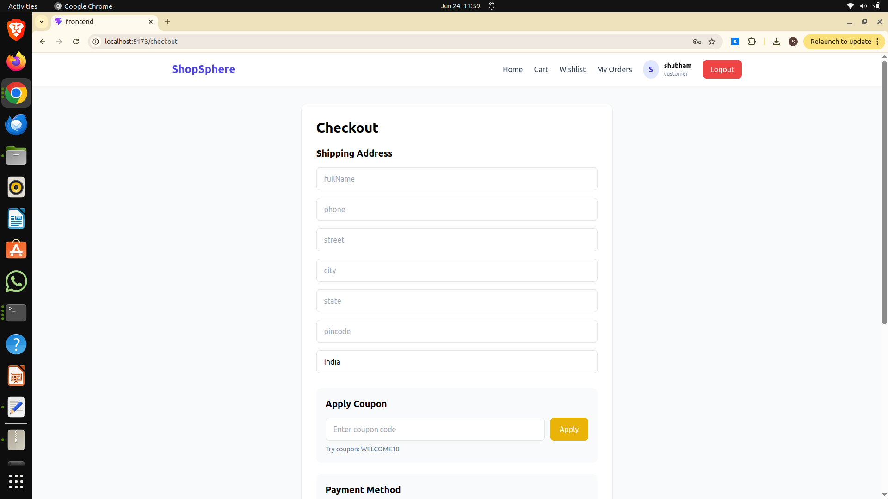
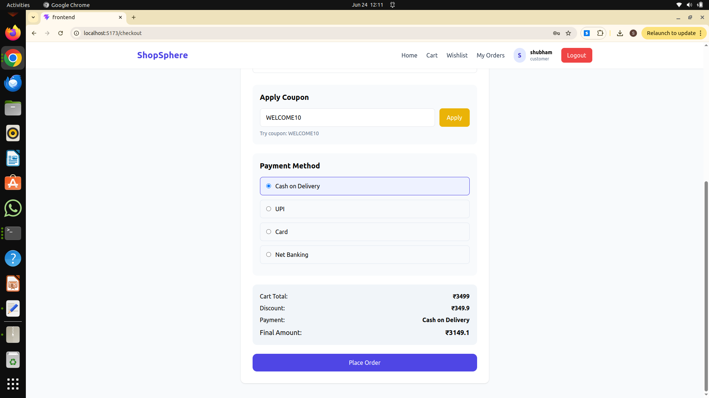
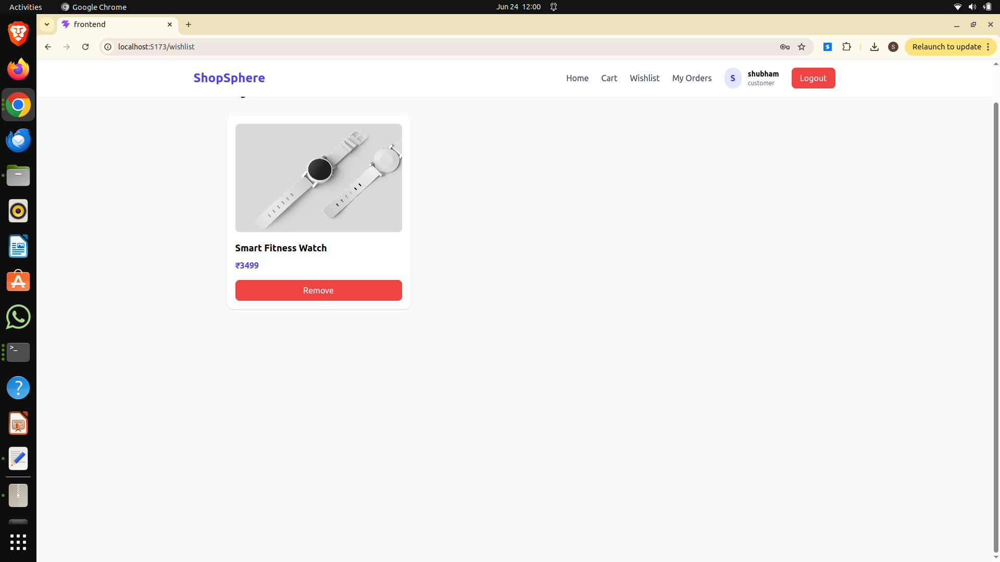
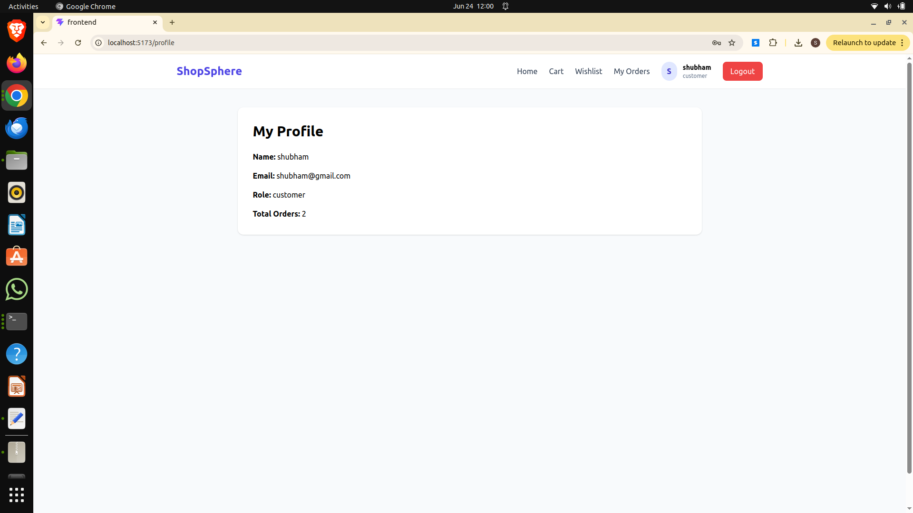
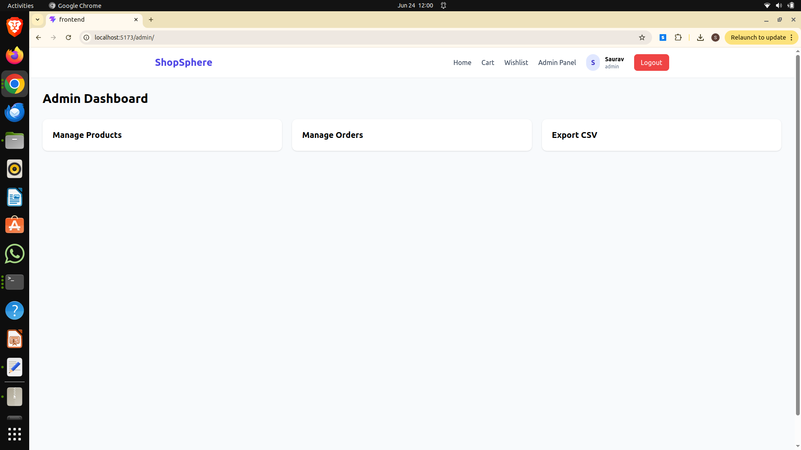
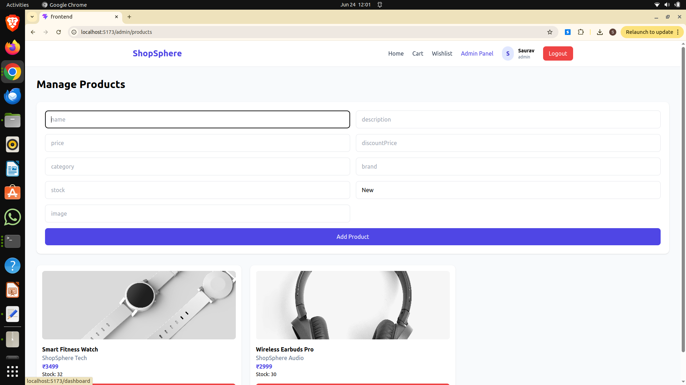
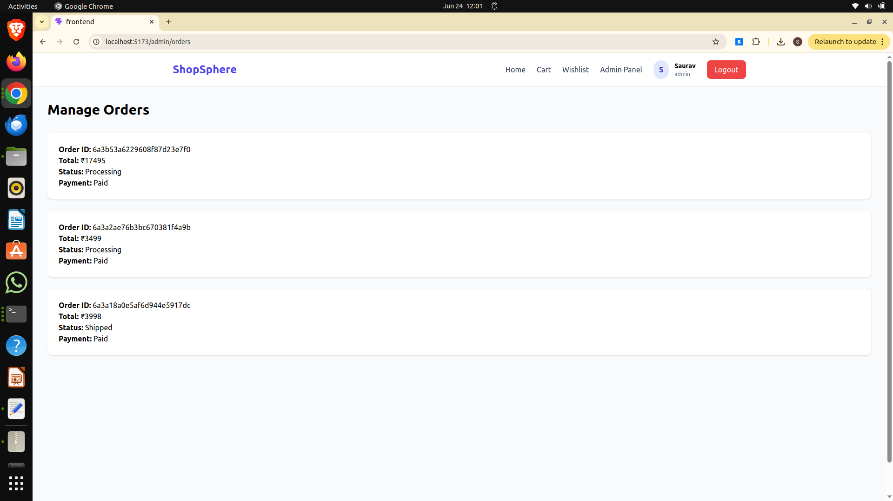
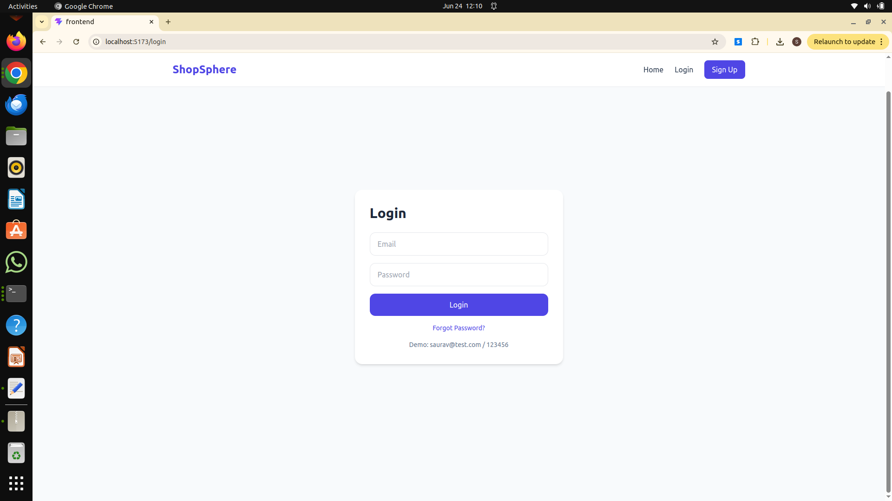
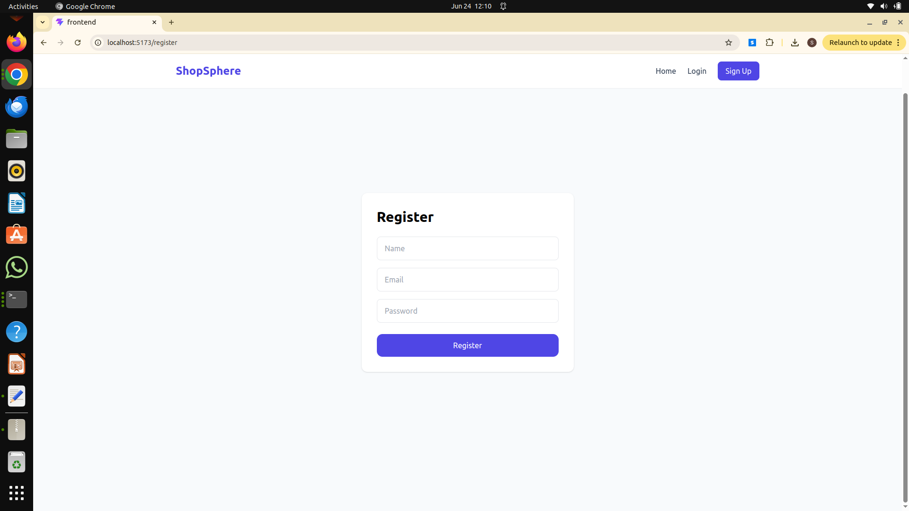
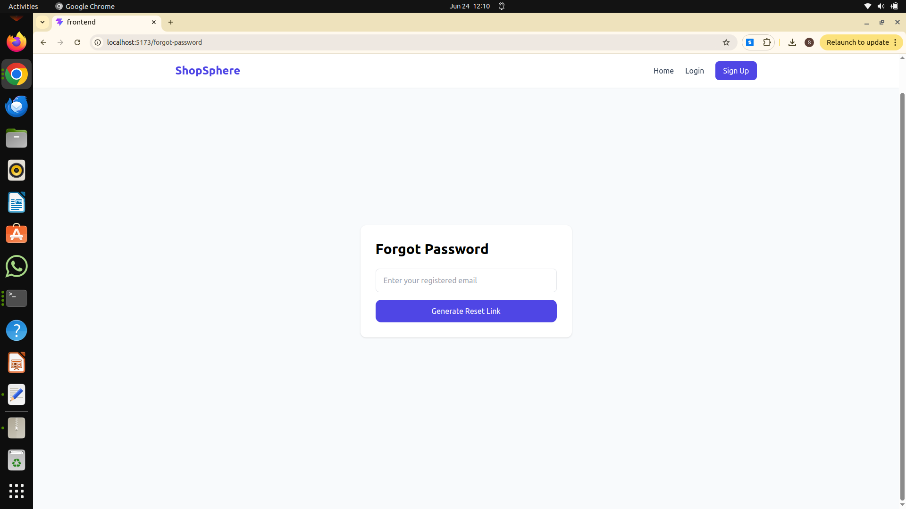

---

# 🎤 Interview Explanation

ShopSphere is a full-stack e-commerce platform integrated with business analytics.  
It supports customer shopping workflows, admin product/order management, coupon systems, payment workflows, and analytics using Kaggle datasets.  
The project combines software engineering and business intelligence, making it useful for Full Stack, Data Analyst, and Business Analyst roles.

---

# 👨‍💻 Author

**Saurav Kumar Singh**  
B.Tech Computer Science and Engineering  
National Institute of Technology Calicut

GitHub:
https://github.com/build-with-saurav
